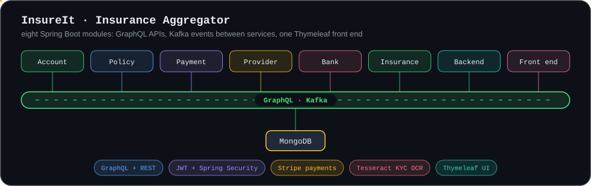
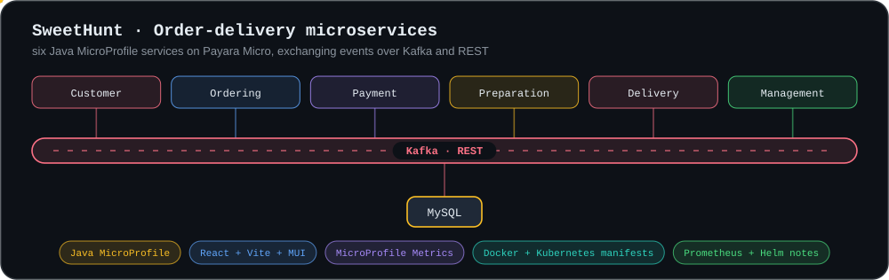
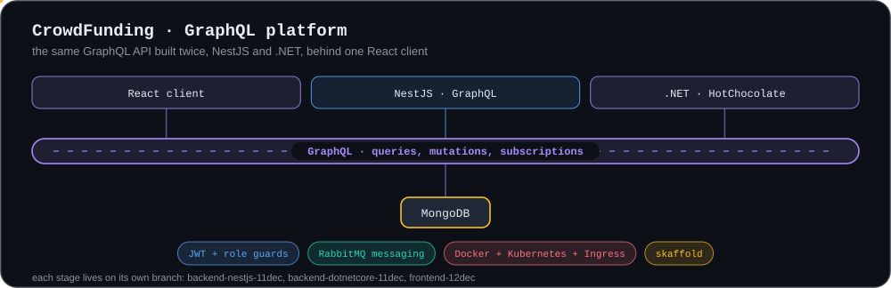
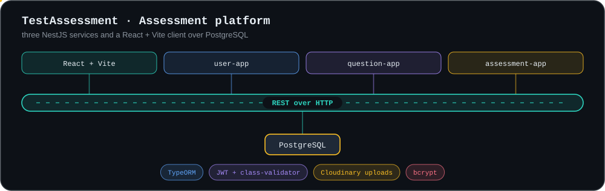

## About me

Hi, I'm **Arya** 👋 a software engineer in Dublin. I have an MSc in Computing (Artificial Intelligence) from Dublin City University, and from 2022 to 2025 I built production backends at LaNet alongside my studies, including an HR system used by 500+ employees.

I like the unglamorous parts of building with AI: deterministic rules where the answer has to be exact, a human in the loop when the model is unsure, and a baseline to beat so I know the thing actually works.

- 🔭 **Right now:** evaluation-first retrieval and agents ([Atlas](https://github.com/Arya-Apr/Adaptive-Retrieval-Router), Entitle) and privacy-preserving edge orchestration ([AEO](https://github.com/Arya-Apr/AEO/tree/updated-aeo-26/06))
- 🧱 **Day to day:** Java with Spring Boot, NestJS, Kafka and RabbitMQ, React front ends
- 🌱 **Learning:** Go and Azure
- 🎮 **Off the clock:** Valorant, my first-ever game, and I still play it
- 📍 **Based in:** Dublin, Ireland

<b>🧭 How I work (click to expand)</b>

&nbsp;

1. **Deterministic where it must be exact, an LLM where it helps.** In Entitle, rules decide eligibility; the model only chooses the next question and explains the result.
2. **Measure it against something simpler.** Atlas is scored on 28 hand-labelled queries against an always-RAG baseline, and the per-query results are published.
3. **Write down where it fails.** Atlas has a "Where it failed" section; my bus-delay model documents that delays over 20 minutes were the hardest to predict.
4. **Review what the AI writes.** I use coding agents, and every change gets read and tested. In AEO that review caught an incorrect reinforcement-learning implementation before it reached the results.
5. **Keep production boring.** Health checks, retries, metrics and dashboards, so failures are visible and quick to triage.

## Toolbox

<b>Everything, grouped (click to expand)</b>

&nbsp;

| | |
|---|---|
| **Languages** | Python, TypeScript, JavaScript, Java, SQL, C++, C# · Go (learning) |
| **AI & agents** | LangGraph, MCP, RAG with SQLite FTS5 and BM25, LLM APIs, PyTorch, Stable-Baselines3, Gymnasium, XGBoost, scikit-learn |
| **Backend** | FastAPI, NestJS, Spring Boot, Java MicroProfile on Payara Micro, Node.js and Express, .NET with HotChocolate GraphQL, GraphQL, REST |
| **Front end** | React, Next.js, Vite, Redux Toolkit, Apollo Client, Material UI, Tailwind CSS |
| **Data & messaging** | PostgreSQL, MySQL, MongoDB, SQLite, Redis, Kafka, RabbitMQ |
| **Infrastructure** | Docker, Kubernetes with skaffold and Ingress, Prometheus, Grafana, Helm (monitoring setup notes), Git and GitHub, Linux, GCP, AWS (50+ skill badges), Azure (learning) |
| **Practice** | Unit and API testing with pytest and Jest, code review, evaluation against baselines, documenting failure cases |

## Featured projects

### AI and data

**[Atlas · Adaptive Retrieval Router](https://github.com/Arya-Apr/Adaptive-Retrieval-Router)**: Azure Python developers often need two different answers in one search: what *their installed SDK* supports and what Microsoft recommends *today*. Atlas uses a Next.js interface and one FastAPI and LangGraph workflow to choose between no lookup, a local index of the installed SDK, Microsoft's public Learn MCP server, or both.

`Python` `FastAPI` `LangGraph` `SQLite FTS5` `MCP` `Next.js` `Redis (optional cache)`

<b>Under the hood, results and where it failed</b>

&nbsp;

- **Index:** rebuilt on startup from the installed Azure Identity and Blob Storage packages: 256 entries, each with symbol, docstring, package version and Microsoft Learn citation. One transaction replaces the index and checks row count and citation uniqueness before commit. Queries use stemming, weighted BM25 and SQL snippet extraction.
- **Hybrid search:** merges the two sources with reciprocal rank, de-duplicates by URL and returns up to ten citations. If Microsoft Learn is unavailable, it returns the indexed matches with a warning.
- **Results** (a small benchmark that I wrote myself):

  | Metric | Queries | Atlas | Baseline |
  |---|---:|---:|---|
  | Correct routing decision | 28 | 24/28 (85.7%) | 12/28 (42.9%), always choose RAG |
  | Target SDK symbol in the top 5 | 12 | 9/12 (75.0%) | 7/12 (58.3%), title-only BM25 |
  | Mean reciprocal rank at 10 | 12 | 0.438 | 0.383, title-only BM25 |

- **Where it failed:** release-freshness questions ("new features in the November release?") skipped the live lookup; "compare `DefaultAzureCredential` with the newest guidance" went to MCP instead of hybrid; and BM25 missed `BlobClient.download_blob` in the top ten for "download a blob into a stream".
- **Reproduce:** `python evaluation/run.py` and `python -m pytest -q`; per-query predictions are in `evaluation/results.json`.

&nbsp;

**[AEO · Agentic Edge Orchestrator](https://github.com/Arya-Apr/AEO/tree/updated-aeo-26/06)**: a research prototype on privacy-preserving data minimisation in smart-building HVAC control. Each room compresses its state to three categorical values, a LangGraph orchestrator decides from those alone, and a PPO agent learns on the same compressed view. *(The latest code is on the `updated-aeo-26/06` branch; `master` holds the first demo.)*

`Python` `FastAPI` `LangGraph` `PyTorch` `Stable-Baselines3` `Gymnasium`

<b>Under the hood</b>

&nbsp;

- **Four control modes run side by side** on the same episodes: raw central control, AEO summaries, an RL policy on the summaries, and a FedAvg federated baseline.
- **Seven metrics:** comfort error, FedAvg convergence rounds, bandwidth per room, energy use, age of information, privacy leakage and orchestration latency.
- **Privacy is attacked, not assumed:** a heuristic and a PyTorch autoencoder try to reconstruct room temperature from the summary stream, and a high reconstruction error means the summaries leak little.
- **Data:** five real office rooms from a Singapore building at 5-minute intervals, with a live dashboard.
- **In my evaluation runs:** 88.7% less bandwidth than raw central control, 0.451 °C comfort error and 4.82 ms orchestration latency.

&nbsp;

**Entitle** *(All-Ireland National AI Hackathon, August 2026, [on GitLab](https://gitlab.com/arya49/project-entitle))*: an agentic benefits-discovery platform. An MCP server exposes official Irish government sources as controlled tools, deterministic rules decide eligibility, and the LLM only picks the next question and explains the outcome. Source provenance, confidence thresholds, sensitive-data minimisation and human review sit around every answer. Deployed on GCP with an OpenAI reasoning model.

**Dublin Bus Delay Prediction** *(DCU machine-learning group project, I owned model training)*: an ETL pipeline over GTFS static, GTFS-Realtime and Open-Meteo weather data (50,000+ merged observations) with weather joined from the closest earlier hour to avoid future-data leakage. Tuned XGBoost reached a test RMSE of 162.65 s (R² 0.618) and beat tuned LightGBM (170.4 s); delays above 20 minutes were the hardest to predict.

**[Echo Chamber Effect](https://github.com/Arya-Apr/Echo-Chamber-Effect)** *(data-mining group project)*: "Mining the Mob", an analysis of Reddit attention and abnormal returns in GameStop using Granger causality tests and XGBoost prediction.

### Full stack and backend

**[InsureIt](https://github.com/Arya-Apr/InsureIt)**: an insurance aggregator for policy discovery, comparison and purchase. Eight Spring Boot modules (seven services and a Thymeleaf front end) expose GraphQL APIs (REST for uploads) and exchange events over Kafka, with MongoDB storage, JWT and Spring Security role-based access, Stripe payments, Tesseract OCR for KYC document capture, GraphQL subscriptions for real-time notifications and a Thymeleaf front end.

&nbsp;

**[SweetHunt](https://github.com/Arya-Apr/sweet_hunt_kafka)**: an order-delivery platform for outlets, delivery staff and customers. Six Java MicroProfile services (customer, ordering, payment, preparation, delivery, management) run on Payara Micro with Kafka messaging and MySQL, behind a React front end built with Vite, Material UI and Redux Toolkit. It ships Docker and Kubernetes manifests, MicroProfile custom metrics and notes on Prometheus and Helm monitoring. The REST-only predecessor is [pizzahunt_rest](https://github.com/Arya-Apr/pizzahunt_rest).

&nbsp;

**[CrowdFunding](https://github.com/Arya-Apr/CrowdFunding/branches)**: a crowdfunding platform built in stages, one branch each. A NestJS GraphQL API (users, projects, FAQs, pledges, likes, bookmarks, JWT with role guards, mail notifications) came first; then a .NET Core and HotChocolate version with RabbitMQ and GraphQL subscriptions for messaging; and a React, Redux and Apollo client with Kubernetes and Ingress manifests. *(`master` holds the first NestJS back end; the other stages are on the `backend-nestjs-*`, `backend-dotnetcore-*` and `frontend-*` branches.)*

&nbsp;

**[TestAssessment](https://github.com/Arya-Apr/TestAssessment)**: an assessment platform split into three NestJS services (users, questions, assessments) with TypeORM on PostgreSQL, JWT authentication, class-validator input checks and Cloudinary uploads, plus a React and Vite front end.

## The path so far

## Every repository, explained

<b>All 23 repositories (click to expand)</b>

&nbsp;

**AI and data**

| Repository | What it is | Stack |
|---|---|---|
| [Adaptive-Retrieval-Router](https://github.com/Arya-Apr/Adaptive-Retrieval-Router) | Atlas: routes Azure developer questions to nothing, the installed SDK index, live Microsoft Learn docs, or both; scored on 28 hand-labelled queries | Python, FastAPI, LangGraph, SQLite FTS5, MCP, Next.js |
| [AEO](https://github.com/Arya-Apr/AEO) | Privacy-preserving agentic edge orchestration for smart-room cooling (latest code on the `updated-aeo-26/06` branch) | Python, FastAPI, LangGraph, PyTorch, Stable-Baselines3 |
| [Echo-Chamber-Effect](https://github.com/Arya-Apr/Echo-Chamber-Effect) | "Mining the Mob": Reddit attention vs abnormal returns in GameStop (group project) | Jupyter, pandas, statsmodels, XGBoost |
| [adk-samples](https://github.com/Arya-Apr/adk-samples) | Fork of Google's Agent Development Kit sample agents | Python, Java |

**Full stack and backend**

| Repository | What it is | Stack |
|---|---|---|
| [InsureIt](https://github.com/Arya-Apr/InsureIt) | Insurance aggregator: eight Spring Boot modules with GraphQL, Kafka, Stripe and KYC OCR | Java, Spring Boot, MongoDB, Kafka |
| [sweet_hunt_kafka](https://github.com/Arya-Apr/sweet_hunt_kafka) | Order-delivery platform: six MicroProfile services with Kafka messaging and a React front end | Java MicroProfile, Kafka, MySQL, React |
| [pizzahunt_rest](https://github.com/Arya-Apr/pizzahunt_rest) | REST-only predecessor of SweetHunt | Java MicroProfile, MySQL, React |
| [REST_OrderDeliverySys](https://github.com/Arya-Apr/REST_OrderDeliverySys) | Fork of the original order-delivery system repository | Java, Payara Micro, MySQL |
| [CrowdFunding](https://github.com/Arya-Apr/CrowdFunding) | GraphQL crowdfunding platform in NestJS and .NET, with a React client, RabbitMQ and Kubernetes (stages live on branches) | NestJS, .NET, React, MongoDB |
| [TestAssessment](https://github.com/Arya-Apr/TestAssessment) | Assessment platform: three NestJS services, PostgreSQL and a React front end | NestJS, TypeORM, PostgreSQL, React |
| [StintStewardship](https://github.com/Arya-Apr/StintStewardship) | NestJS GraphQL API for students, teachers, subjects and tasks, with JWT, role guards and mail | NestJS, GraphQL, MongoDB |
| [Pharmacy-Project-API](https://github.com/Arya-Apr/Pharmacy-Project-API) | NestJS API for a pharmacy: medical products, product types and JWT-protected users | NestJS, TypeORM, MongoDB |
| [graphql-kubernets-demo](https://github.com/Arya-Apr/graphql-kubernets-demo) | Fork of a NestJS GraphQL and Kubernetes (skaffold) demo | NestJS, GraphQL, Kubernetes |

**Learning and coursework**

| Repository | What it is | Stack |
|---|---|---|
| [it2024-Java](https://github.com/Arya-Apr/it2024-Java) | Jakarta EE coursework: EJBs, messaging, timers, JSF and PrimeFaces, JSP and servlets, JPA, SOAP, security | Java, Jakarta EE |
| [066_ASSIGN_2](https://github.com/Arya-Apr/066_ASSIGN_2) | Node.js college assignments: Express and Mongoose, file uploads, Passport sessions with Redis, JWT | Node.js, Express, MongoDB |
| [66_College_Assignments](https://github.com/Arya-Apr/66_College_Assignments) | MEAN-stack theory assignment (PDF) | |
| [webmaster-exam-2026-egm-starter-pack](https://github.com/Arya-Apr/webmaster-exam-2026-egm-starter-pack) | Fork of the Redbrick (DCU) Webmaster Exam 2026 starter pack, with a docker-compose setup and written theory answers | Python, FastAPI, Vite, Docker |
| [blockbot](https://github.com/Arya-Apr/blockbot) | Fork of the Redbrick Webgroup's Python Discord bot | Python |

**Git practice**

| Repository | What it is |
|---|---|
| [starter-web](https://github.com/Arya-Apr/starter-web) | Fork of a Git and GitHub workshop sample site |
| [website](https://github.com/Arya-Apr/website) | Fork of a Git workshop exercise repository |
| [demo](https://github.com/Arya-Apr/demo) | Branching and merge-conflict practice |
| [Test-git](https://github.com/Arya-Apr/Test-git) | Small Git practice repository |
| [gitfiti](https://github.com/Arya-Apr/gitfiti) | Empty placeholder repository |

## Let's talk

I'm always happy to talk about retrieval, agents and keeping things reliable. The best way to reach me is on [LinkedIn](https://www.linkedin.com/in/arya-apr/).

